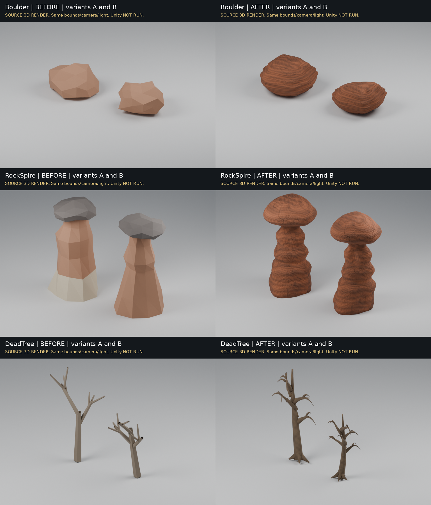
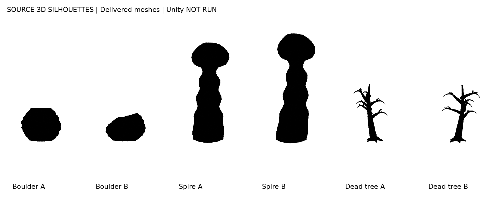

# Actual L2 source evidence

These are actual 3D renders of delivered meshes. Unity screenshots, gameplay video and native performance evidence are NOT RUN. No generated concept image stands in for a game screenshot.

Before geometry was exported by tools/measure_redspire_l2.cs from the unchanged WildsShapes implementation, with fixed seeds 123 and 220. Its source OBJs are retained under SourceGeometry. The neutral before palette approximates the original material slots; it is not a reproduction of Unity's procedural shader. After geometry is copied from the delivered editable .blend and fitted to the identical prior geometry bounds, matching the runtime envelope policy. Camera, light, render resolution and framing match within each family. See render-manifest.json and tools/render_redspire_l2.py.

Silhouettes use the actual six source meshes and an opaque black material override. See tools/render_redspire_silhouettes_l2.py. Individual BEFORE and AFTER PNGs retain both variants at 768 by 600. The combined comparison is 1536 by 1800. These establish source shape differences, not real in-game appearance.

Art source: ArtSource/RedspireL2/RedspireWildernessL2.blend. Runtime exports: Assets/NeonSyndicate/Art/LiveWilds/{Boulder,RockSpire,DeadTree}. Texture maps: Shared. ASSET_MANIFEST_L2.json seals all 25 original source/model/map files. Blender reopen/reimport validation passed 91 checks; an independent strict FBX parser accepted all 18 meshes. Native importer axis/material/LOD behavior is still open.

For real evidence, use OWNER_GUIDE_L2.md. Capture the same ordinary camera before, during legacy comparison and after restoration, at identical daylight/evening, resolution and quality. Leave HUD visible. Do not use a debug teleport or a cinematic as route proof.
