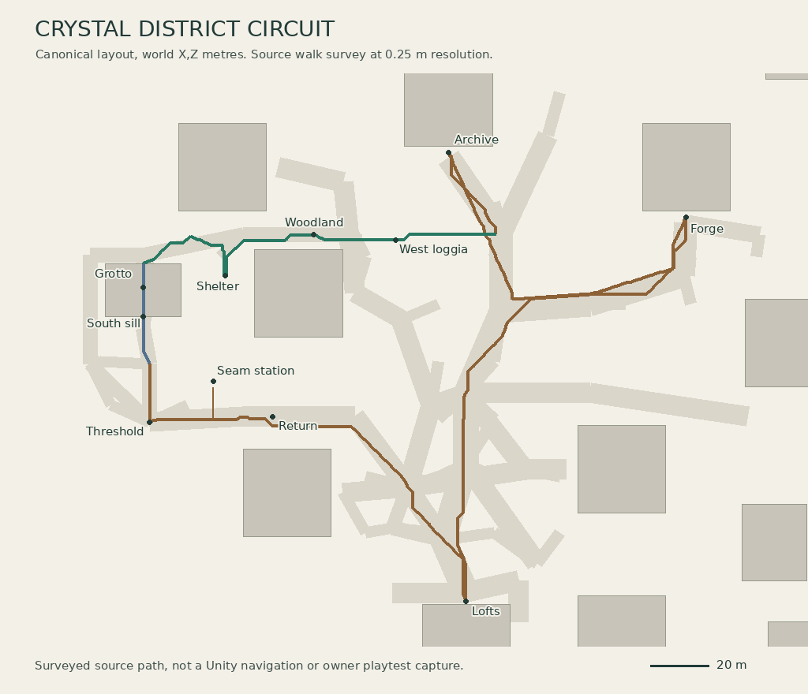
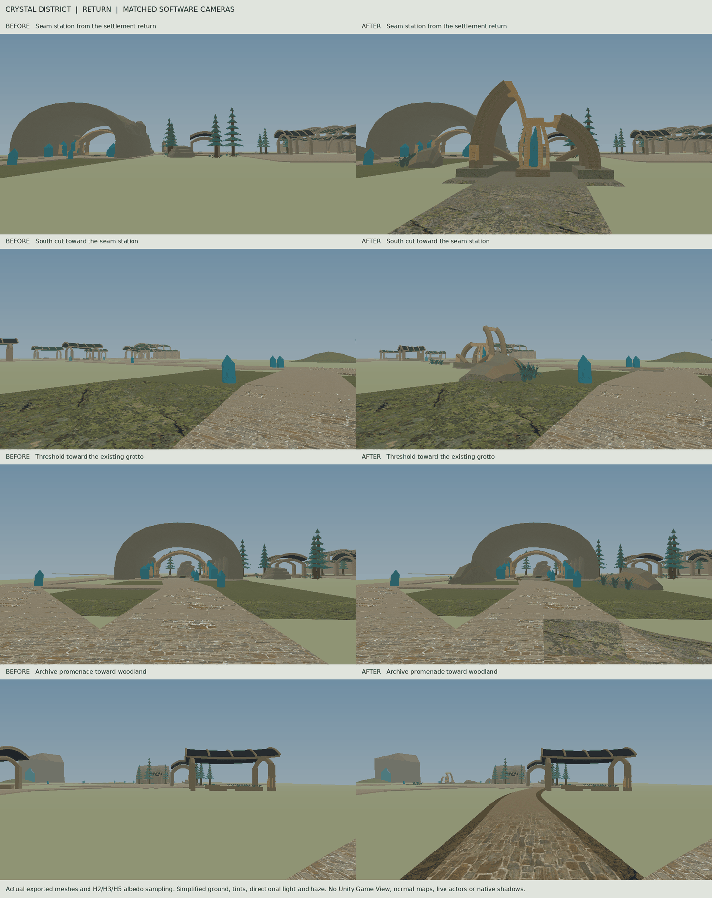
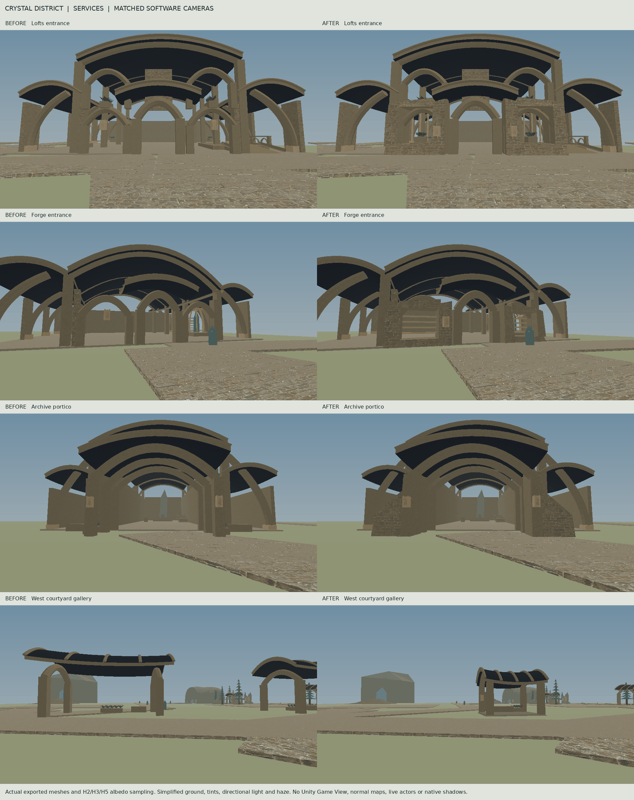

# Crystal District Circuit

The settlement, woodland and grotto now have a continuous source-surveyed return to the Lofts. Enter through PLAY FANTASY WORLD on the supported civic layout. The source survey completed all 16 legs over 706.39 metres and a separate 10.5 metre approach to the seam station. Physical traversal and visual acceptance in Unity are pending.

Starting published HEAD was 3afc7d4e12987b2d404baa7e40c19e6cd0666109. The first forward checkpoint is 4a9c141709320411d28d7e4b12d573526e661a53. Its push and PR route/art runs all passed. The following finish commit contains the reviewed geometry, material treatment, retry correction and evidence. Use the published finish SHA and its own Actions links in the delivery response. PR12 remains draft and unmerged on feature/04o-shattered-metropolis-reborn. PR11 was untouched.

## The route

| From | What the player should find |
| --- | --- |
| Lofts and courtyard | Deep screened bays with planted sills, wall-mounted lamps and an open home doorway. Six sheltered court galleries now occupy surveyed parcels. Five previous placements intersected existing route lanes at walking height. The eastern gallery at (24,52) stays in place. |
| Forge and Archive | The Forge front has recessed heat vents and an alloy elbow connected to the existing core. The Archive portico has tapered stone returns. The central service passages, Dante, anvil, lectern and retained Archive dais remain under their original owners. |
| Archive to woodland | A supported 50 metre promenade runs from the actual sanctuary-approach at (12,92) to sanctuary-wilds at (-38,92). Its slight bow passes the west loggia. The longer clinic connection also remains available. |
| Woodland and grotto | The shelter apron now extends inside the arrival bay and checks its full footprint for openings. The mineral landmark, northern grotto entrance, original hollow cave and quest destination at (-110,74) remain in place. |
| South mouth and seam court | A fitted, supported sill from z70 to z60 completes the exit at (-110,64). Two unequal banks around (-119,57.5) and (-99,50) frame the mouth. Non-solid reeds and ferns grow outside the solid toes. The five-metre grotto-through-route continues through (-108,48) to (-108,28). |
| Threshold and settlement return | Low fan-shaped paving rounds the north-to-east turn. A braced crystal station at (-86,42) sits on a founded terrace outside the 16 metre observation radius, reached by a sloped apron from Shardwood. A sheltered seat and planting near (-65,39) mark the inhabited return. The existing seven-metre shardwood-threshold route reaches (-20,6), then home-dispatch joins home-court. |

We kept the actual flat route rather than excavating it. The banks supply the southern silhouette and the threshold view looks back through the existing cave mouth. The exported triangles leave that sightline open from (-108,1.82,29) toward (-110,3.2,64.1). The clinic parcel lies between the threshold and the Archive in plan, so this delivery makes no claim of an uninterrupted Archive vista.

The stage admits walk surfaces only after checking the entire footprint. An opening in a planned walking bed rejects the whole affected bed. Above-ground fixtures reserve the actual routes and quest court. The station has a contained crystal core, two asymmetrical stone arms, alloy joints, rear retaining cheeks and a separate inspection approach. The outer seam, its impression and The Grotto Listener continue to use the existing quests and progression.

## Architecture and materials

The new meshes are editable procedural C#. The circuit has a south sill, promenade, turning fan, stone banks with a mineral seam, a braced station, grounded terrace, maintenance apron, sheltered planting and reed blades. Reeds and other leaves remain outside the candidate solid. All solid roles supply the same vertices and indices to visual and collision owners.

The finishing pass adds deep masonry window reveals at the Lofts, vented Forge openings and a power connection to the actual Forge core, plus weathered side returns at the Archive. Shorter western galleries and longer eastern shelters vary the courtyard outline. Their beveled footings ground the piers, seats and wind cheeks. The source audit found real intersections with first-phenomenon, dispatch-clinic, shardwood-threshold, garage-foot-return, pressure-return and several neighbour lanes. The revised six bays passed the full lane and headroom checks.

The district uses its existing H2 maps, H3 masonry/basalt and H5 iron where selected by AscensionArtH2. Roof UVs now continue across adjacent panels at a two-metre repeat. Per-renderer material blocks distinguish weathered masonry, slate, metal and earth roughness. No shared or local material asset was overwritten. Night and earned Third Eye still use the original atmosphere heartbeat and ability state. Stronger resonance remains confined to the existing cool fixture role.

These are software perspective renders from 1.67 metres above the route curb. They use exported production meshes, UVs, H2/H3/H5 albedo, approximate tints, a directional light and distance haze. They simplify ground and omit native normal/roughness response, native shadows, actors and unexported interiors/structures. The images do not establish Unity appearance or performance.

## Physical ownership and verification

| Owner | Responsibility |
| --- | --- |
| HeartPlanFR01.ScienceCircuit.cs | Route matching, southern meshes, turn, station, promenade and area admission |
| HeartPlanFR01.ScienceDistrict.cs | Service reveals, courtyard placements and foundations, shared vault UVs |
| HeartPlanFR01.ScienceArchive.cs | Archive entrance and one ScienceCircuit append inside ScienceApproach |
| HeartPlanFR01.ScienceFrontier.cs | Shared footprint protection and the full woodland shelter bed |
| VenueView04C.ScienceDistrict.cs | Existing CityBuilder.StageScienceCourt passes the actual layout into court admission |
| HeartPresentationFR01.ScienceDistrict.cs | Existing visual/physical pair, material state, retry ownership and matching physical sibling lookup |
| VisibleRealityV0.StructureProbe.cs | Camera-centre reporting for verified ScienceDistrict siblings and independent collider hits |
| CityLayout.Fractured04OC, CityBuilder.Gothic04OB/Fractured04OC, GothicRealmGeometry04OB.Grotto | Original route graph, supported boxes, terrain, guide minerals and hollow grotto |

World/HeartFR01 owns the HeartPlan and presentation files. VenueView04C lives in Scripts/Runtime/ArtInhabitedCity04C and the inspector in Scripts/Runtime/UI. Save, quest, character, vehicle, original layout, original service structure and regional collision owners remain unchanged.

A second preparation previously returned false for an already registered pair, instructing the caller to emit a second original. A valid original under the same parent now returns handled. Mesh-dependent zone construction and material preparation complete before registration. A failed collider construction releases its partial object. The existing selection waits for occupied changed surfaces and switches visuals and physical roots together. A native regression fixture for three preparation/activation/restoration cycles compiled but was not executed.

The camera probe also used Transform.Find on a sibling name containing a literal slash, which Unity interprets as a hierarchy path. The corrected lookup matches the actual direct child name and collider. This repairs the known ScienceDistrict sibling lookup. It does not identify either owner-reported giant.

See [SF05_EVIDENCE](SF05_EVIDENCE) and the final Actions runs. The grid survey uses 25 cm spacing, a 45 cm test body radius, four height slices of the exported solids, supported floors, sampled top surfaces and a maximum 20 cm step. It treats occupied unexported parcels as obstacles, includes the actual planned Underheart openings and uses bounded flat ground across the short original service-door gaps. The largest height change on the resulting route was 16.4 cm. This is source geometry evidence, with no Unity controller, companion pathfinding, live traffic or physics cooking.

| Verification | Result |
| --- | --- |
| Managed player / combined editor and tests | 1,080 / 1,348 sources, 0 errors, 20 / 67 warnings |
| Pure geometry outside Unity | 10 circuit, 21 district, 8 woodland and 9 grotto cases passed |
| Preservation | WR01 59/59, WR02B 162/162, 10 source/mutation contracts and 21 switching/clearance math checks passed |
| Syntax and metadata | Twelve C# 9 configurations passed. 2,835 audited metadata entries, zero invalid/unresolved references, 13 metadata regressions passed. All 2,837 existing tracked metadata files unchanged. |
| Assets and recovery | Full LFS hydration and fsck passed. The recovery archive still contains 181 local_delta files. |
| Native Unity | Editor and Blender executables unavailable, DISPLAY unset, AF_UNIX creation returned EPERM. Unity import, Game View, physical walk, camera, companions, earned flight, native switching, save/reload, profiling and owner acceptance remain pending. |

Workspace maintenance had pruned the earlier checkout. This sprint restored the repository from the published branch and verified the separate recovery archive SHA256 9ec36c5db92eeb99ef737de75d3a7d389875c81f66ba0d5229f6ef43d4b75e42. No recovered delta was overlaid onto the branch. The archive, previous references and all historical receipts are preserved.

## Remaining defects and one owner playtest

The fresh source inventory still identifies family-9 seeds 809556, 32874 and 53496 and the optional Forge roof landmark at seed 584924 as candidates only. The first group uses FracturedReliquary04OC and a separately emitted exact compound collider. The optional roof composer can place a renderer above the original roof without its own corresponding collider. No new camera evidence identifies either reported giant. FR01/FR02A first loading refusal remains unreproduced. Both issues still require their specific runtime evidence.

Use Unity 6000.3.16f1. Run Acceptance > Verify Fantasy World and PLAY FANTASY WORLD with a separate test bank. In one session, follow the map from Lofts through Forge/Dante/anvil, Archive lectern, the west promenade, woodland shelter and grotto. Leave through the south mouth, visit the station from the threshold, then return through dispatch to the Lofts. Check companion/camera clearance, normal night and already earned Third Eye, earned flight and landing. Request End review while occupying new paving or a roof, then move all actors clear and verify visual and physical restoration. Re-enter and save/reload the test bank. Use F2 > Fantasy proof > Inspect structure at camera centre for each visible giant and retain its report, Game View image and any first load error.

## Reference assessment and resume

The comparison used leading references 15, 16 and 20. The station has a recognizable engineering function and the service fronts now differ at walking height. The three largest remaining gaps are:

1. Upper building massing. The Lofts and Forge still share broad vault and arch profiles above their new frontages. The reference homes and workshop have distinct occupied upper volumes, stepped roof terraces and purpose-specific roof equipment.
2. Landscape depth. The return is legible, but flat open intervals separate the near banks from the skyline. The reference compositions have overlapping rock, tree and distant terrain layers. Actual in-game fog and background coverage still need owner review.
3. Inhabited detail. Street scale and stone continuity improved, but the exported upper galleries and working edges remain sparse beside the reference's maintained planting, shutters, service fittings and material transitions. Judge native materials and lighting in Game View before assigning a lighting repair.

Next sprint: first address any demonstrated native circuit defect. Otherwise, rebuild the Lofts' inhabited upper terrace and the Forge's vented working roof as two distinct silhouettes visible on the ordinary home-to-Forge walk. Keep the existing service frames, roof receipts, interior anchors, physics pairing and preview defaults. Stay in the developed region.

Immediate rollback is End review after clearing changed surfaces or Stop Play. For code rollback, forward-revert the final finish commit, then 4a9c141709320411d28d7e4b12d573526e661a53. Preserve subsequent changes and resolve conflicts deliberately. Keep PR12 draft on feature/04o-shattered-metropolis-reborn. Fetch actual latest HEAD before resuming.

Reproduce the views with the exact-version managed compilation tool, then tools/export_science_frontier.py --circuit for the starting and finished assemblies, tools/check_science_circuit_walk.py for the final export and tools/render_science_circuit.py for the matching cameras. The native retry test lives in ScienceCircuitNativeTests. Its status remains pending until run in Unity.
