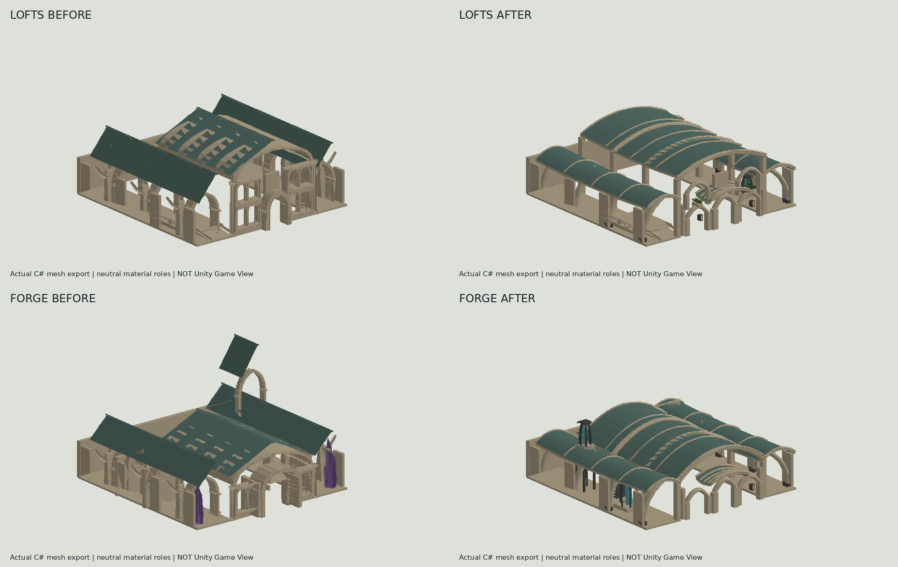
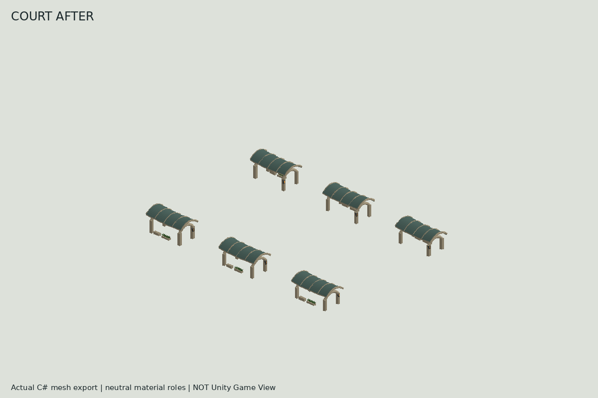

## First beast carriage

Read [FIRST_BEAST_CARRIAGE.md](FIRST_BEAST_CARRIAGE.md) for the hydrant loading stop, one-way freight run, actual motion evidence, verification and rollback.

## Lofts terrace and Dante exhaust crown

Read [LOFTS_TERRACE_FORGE.md](LOFTS_TERRACE_FORGE.md) for the current architecture, matched cameras, verification, owner pass and rollback. Earlier receipts follow.

## Crystal District Circuit continuation

Read [CRYSTAL_DISTRICT_CIRCUIT.md](CRYSTAL_DISTRICT_CIRCUIT.md) first for the southern return, complete source survey, player-height comparisons and rollback. Earlier receipts follow.

## Resonant Grotto continuation, 2026-11-03

Read [RESONANT_GROTTO.md](RESONANT_GROTTO.md) first. The woodland route now reaches the retained grotto entrance and arrival. Native acceptance is pending. Historical receipts follow unchanged.

## Crystal Frontier continuation, 2026-11-03

Read Docs/ScienceDistrict/CRYSTAL_FRONTIER.md first. The connected woodland threshold extends the existing paired ScienceDistrict preview. Native acceptance is pending. Preserve the 181 recovered files and fetch actual latest HEAD. Historical receipts below remain unchanged.

> Latest continuation: [Archive extension](ARCHIVE_EXTENSION.md), 2026-11-01, based on published 6cb604a8. The report below is retained historical evidence for the first sprint.

# Sculpted home-to-Forge district, source implementation

Date: 2026-11-01. Repository: tycs1992-RBT/NeonSyndicate_LasVeyra.
Branch: feature/04oh-ascension-art-foundation. PR12 remains draft and unmerged,
with base feature/04o-shattered-metropolis-reborn. PR11 is untouched.
Starting published HEAD: 2c1169f22cc3a6352a03a83815601911b18282d8.
First published implementation checkpoint: 1f07e7a242a8c22fac6173bf7bee48714ee3d672.
The subsequent forward checkpoint includes the support refinement, status handling and this evidence.

## Delivered geometry and selection

The supplied ZIP was read and its actual leading images opened. R15, R16 and R20
govern the sculpted forms, framed power equipment and restrained materials.
Earlier medieval studies supply atmosphere only. No concept image became a game texture.

- Lofts: broad swept roof, four grounded arch frames, open side galleries,
  upper planting, a caged home power unit and warm entrance fixtures. The
  original porch ramp, rail, occupied rooms and any receipt landing remain.
- Home court: six curved, open arcades replace the original court composition,
  with seats, planters and recessed warm fixtures. The centre stays open.
- Forge: a higher swept work-hall roof, open side gallery, caged crystal
  machinery, manifold, fins and a supported offset condenser above the eave.
  Dante and the anvil remain at their original anchors in the original room.
- Existing Archive and both WR02J small dwelling treatments remain in their
  published owners. This sprint does not claim to redesign the Archive.

The kit is editable C# geometry, UVs, normals and material-role integration,
not a Blender asset or a concept-art delivery. It reuses the intact H2/H3/H5
albedo, normal and metallic maps. Per-renderer property blocks change the new
surfaces only; shared materials and existing GUIDs are not overwritten.
Ordinary night uses Atmosphere.NightFactor. Stronger crystal resonance reads
Abilities.ThirdEyeActive, which still requires its original earned unlock and
energy. No additional clock, ability, interaction, quest or reward was added.

Revision 10 plus the existing explicit PLAY FANTASY WORLD session selects this
candidate. Ordinary play retains the original exterior. H2 geometry/maps must
be valid; this kit does not depend on FR01/FR02A prepared prefab readiness.
Those layers can still refuse independently. Their missing catalog/material
reason remains visible; active science architecture reports partial delivery,
never successful import of a failed layer. A checkout stamp is still required.

## Source and physical ownership

| Owner | Change |
| --- | --- |
| HeartPlanFR01.ScienceDistrict.cs | Deterministic architecture, closed roof/beam surfaces, exact solid union and state-dependent emission values |
| VenueView04C.ScienceDistrict.cs | Captures complete original Lofts/Forge exterior before shared batching; retains all room owners; builds court alternative |
| VenueView04C.GothicHeartH3.cs | Two bounded hooks to select the staged service or court transaction, otherwise the previous emitter runs |
| HeartPresentationFR01.ScienceDistrict.cs | Owns paired exterior visuals and colliders in the existing Heart lifetime |
| HeartPresentationFR01.WorldRewrite.cs | Dispatches those explicit physical pairs through existing preview policy and proof |
| VisibleRealityV0.HeartFR01.cs | Existing heartbeat reviews paired state and time/vision emission |
| VisibleRealityV0.StructureProbe.cs | On-demand camera bounds candidates and exact collider ray hits in the existing proof page |
| FantasyProofV1.cs | Retains real preparation refusal while distinguishing independently active architecture |

Source paths above are under Assets/NeonSyndicate/Scripts/Runtime, in
World/HeartFR01, ArtInhabitedCity04C, UI or QA as appropriate.

This is an intentional physical exterior redesign. The original complete
shell collision is isolated instead of being left in the old shared court
collision batch. Candidate collision comes from the same triangles as every
solid visible role. Only soft leaves are excluded. Both visible and physical
roots switch synchronously. A failed or destroyed candidate restores the
original pair. A switch waits while a character/creature or vehicle occupies
the changed entrance, gallery or roof zones. It retries through the existing
Heart heartbeat. Thus End review can remain visibly pending until actors move
clear; Stop Play destroys the temporary scene normally.

No layout, route, room wall, service/quest anchor, character rig/controller,
progression, save schema or default was changed. See preserved-owners.json.
Physical cooking, actor overlap and teardown behavior still need native testing.

## Actual source review, not Game View

The images are simple software projections of the actual C# mesh export,
using neutral role colours. They omit unchanged occupied room contents,
surrounding terrain and textures. The sampled service binding has no optional
receipt roof; runtime retains that roof through the original Structure call.
The left column is the H3 fallback shell, not a screenshot of WR02I's relief.
These images prove neither import nor gameplay appearance.

Sampled candidate totals: Lofts 16,064 triangles, Forge 16,456, court 16,392.
The same bounded candidate envelope is used at every graphics setting and
visible LOD; no simplified roof drifts away from its collider. Original roots
remain allocated for rollback, so native memory/performance remains unmeasured.
See mesh-counts.txt. tools/export_science_district.cs exports the actual plan
against a successful managed build; tools/render_science_district.py renders
its OBJ folder. No fabricated Unity capture is included.

## Verification

| Gate | Current evidence |
| --- | --- |
| SOURCE / ASSET PRODUCED | Implemented; original resources, art payloads and protected owners preserved. Full history checkout and 2,382 SHA256-verified hydrated payloads available. |
| Managed compilation | Classic player: 1,075 sources, 0 errors, 20 warnings. Combined editor/tests: 1,340 sources, 0 errors, 67 warnings. Installed Unity managed references, not a running Editor. |
| Syntax | All 12 C# 9 symbol configurations, zero syntax errors. This is not 12 native builds. |
| New pure tests | 14 pass: bounded finite geometry, solid correspondence, doorway/service/court clearance, retained supports, frame refusal, night/vision separation and truthful partial-preparation reporting. |
| Prior geometry | WR02J 12 cases pass; WR02I 8 cases, 211,726 assertions and 162,610 support samples pass outside Unity. |
| Prior source checks | Preparation failure contracts 3/3 and route integrity 3/3 pass. WR02J 3/5 and Forge preparation/contracts 4/5: exact historical owner hashes reject this authorized redesign. |
| UNITY IMPORT / NATIVE COMPILE | NOT RUN. No runnable Editor or Blender; current Unix socket creation returns EPERM and no display is configured. Managed compiler files do not establish licensing or Editor usability. |
| GAME VIEW / COLLISION / GAMEPLAY | NOT RUN. No walking, flight, landing, camera, companion, service or native physics acceptance claimed. |
| SAVE/RELOAD / PERFORMANCE / OWNER ACCEPTANCE | NOT RUN. No actual save was opened or rewritten. |

Current checkpoint CI is red, not the old route-green/H5-only situation:
[route run 41267353792](https://github.com/tycs1992-RBT/NeonSyndicate_LasVeyra/actions/runs/41267353792)
fails WR02J exact owner preservation; later route/native-reference stages skip.
[art run 41267353793](https://github.com/tycs1992-RBT/NeonSyndicate_LasVeyra/actions/runs/41267353793)
passes FR01 144/144, FR02A 185/185 and proof 33/33, then fails WR01 at 54/59
on additions/exact integration guards. WR02 onward, including H5, skips.
These links concern 1f07e7a, not the later delivery head. Inspect the later
commit's checks separately. No inherited assertion, exclusion or hash was
refreshed to make CI green. A reviewed preservation-contract extension is
still required before this physical phase is mergeable.

## Giants, loading refusal and recovery

Both recovered owner captures were reviewed during recovery. Neither selects
a renderer/collider or supplies sufficient pose/world coordinates. Neither
giant has been conclusively identified or removed.

Candidates remain the isolated family-9 skyline lots 809556, 32874 and 53496
(GothicRealmGeometry04OB.FracturedReliquary04OC), generic material-batched
CityBuilder geometry, and optional CrystalCity02F roof landmarks. The latter
explicitly have no new platform physics and can be near the Lofts arrival.
These are source-owner candidates, not claims that either pictured giant is
one of them. Exact selection is required before removal. New proof inspection
logs full renderer paths/bounds and independent world-collider ray hits;
bounds intersections and nearest ray hits are not falsely equated.

The owner's FR01/FR02A preparation exception remains unreproduced without
Unity. Existing receipt/cache repair and first-exception retention remain.
The new partial-status handling makes no Ready flag true. The previously
captured ClosestPoint warning has no stack establishing its caller; it is not
claimed fixed, and this sprint does not add ClosestPoint calls.

The recovered original workspace remains intact. Its unpublished WR02K Oath
Gallery/Archive art and incomplete WR02L threshold hooks were preserved in the
earlier recovery snapshot and were not silently published with this sprint.
Implementation used an isolated checkout. A local Git checkpoint is retained;
shell push lacked credentials, so forward GitHub connector publication was
used with an expected-HEAD lease and exact local/published tree comparison.

## One combined owner test and rollback

1. Fetch/pull this branch, open Unity 6000.3.16f1, and run the existing
   Acceptance > Verify Fantasy World preparation. Use an isolated review save
   or backed-up test bank. Keep the first red Console error if import fails.
2. Enter the existing PLAY FANTASY WORLD review. From the Lofts front at
   (0,-34), walk north through the court to (0,38), then (12,66), (42,68),
   (74,78) and the Forge entrance at (75,100). Check the new roofs, galleries,
   home fixture and Forge core. The Archive stays ahead of the northern route.
3. Use home access, Dante and the anvil; make one return through the Archive
   lectern. Check companion passage, doorway/camera clearance and, if already
   earned, flight and roof landing. Inspect normal night and earned Third Eye
   separately. Do not unlock progression for this test.
4. If a giant is visible, aim at it and press F2 > Fantasy proof > Inspect
   structure at camera centre once; retain the Console report and Game View.
   Note any exact layer preparation refusal on that same page.
5. Move everyone onto the open central route, End fantasy review, and check
   that old appearance and collision restore together. Re-enter once, then
   save/reload only the test bank and confirm original progress/services.

End fantasy review is the visual/physical rollback. If a pair is waiting for
clearance, move off its entrance/gallery/roof before ending; Stop Play also
clears the session. Reverting this sprint's commits should be a future forward
revert, never a reset, rebase, forced update or save migration.

## Ordered remainder

1. Native import and the single combined playtest; fix any real geometry,
   material, overlap, interaction or restoration defect before promotion.
2. Resolve preservation CI with narrowly reviewed, mutation-tested ownership
   contracts for this authorized physical phase, retaining prior assertions.
3. Identify each giant from the new native evidence and replace its confirmed
   visual/physical source together. Reproduce the first actual load exception.
4. Refine street-level massing and occupied frontage against matched Game View,
   then extend toward the Archive and natural transition. Broader terrain,
   forest, grotto and creature transformation remains a later program.
5. Organic transport pilot: TrafficManager/TrafficDriver own ambient lanes;
   TrySpawnParked owns ambient parked cars; SpawnParkedAt and MissionCritical
   protect service/mission vehicles; Vehicle, TrafficManager.Bikes and their
   existing save/service owners retain player transport. No transport was
   replaced. A future beast requires anatomy, gait, harness, wheel motion,
   turning/avoidance and equivalent interactions before entering live traffic.

Malik's established identity, current equipment/rig and progression remain.
No transport asset, new portal, new story or finished fantasy RPG is claimed.
